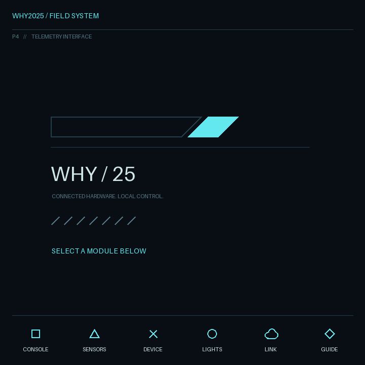

# WHY2025 badge with ESPHome

ESPHome on the WHY2025 ESP32-P4 badge, with an LVGL keyboard-driven desktop,
Home Assistant light controls, a Bluetooth proxy, and live sensor readings.



This is a working community experiment, not an official WHY2025 firmware release.
The configuration was tested on an ESP32-P4 revision 1.0 badge with a production
Bono/ST7703 720 × 720 panel, 16 MB flash, 32 MB PSRAM, and an ESP32-C6 radio.
Other hardware revisions may need changes. The screen is not a touchscreen.

## What works

- Six apps mapped to the physical shape keys: console, sensors, device/keyboard
  diagnostics, Home Assistant lights, network setup, and guide.
- Wi-Fi setup on the badge keyboard; credentials are saved locally in NVS.
- Light discovery by one Home Assistant automation. Select, toggle, dim, and
  search lights without maintaining a compiled entity list. Unavailable lights
  are hidden and reappear when their states recover.
- Bluetooth proxy through the C6 hosted controller.
- BMI270 acceleration, angular velocity, temperature, pitch, and roll.
- BME690 temperature, humidity, and pressure.
- Screen and keyboard backlight control through custom C6 firmware.
- SNTP clock and ESPHome native API / OTA updates.

## Known limitations

- Display flicker is unresolved. Full-screen blue flashes during OTA were
  observed; Espressif documents a similar symptom when display DMA cannot fetch
  pixels from PSRAM fast enough. That diagnosis has not been confirmed by
  capturing an underrun log during an update. Panel settings remain experimental.
- BME690 gas ADC saturates on the tested badge. Saturated readings show **Out of
  range**, not a fabricated air-quality score. For valid samples, the code offers
  a relative baseline and minute trend; these are not VOC ppm, BSEC IAQ, or health
  thresholds. BSEC is not included.
- The SD slot has mount/status and root-listing code, but no usable card was
  available to verify it. Current toolchain builds warn that POSIX directory
  functions may resolve to stubs; file browsing is not claimed to work. No card
  formatting, logging, hotplug handling, or file writing is implemented.
- Audio targets the LS1 speaker connector; audible output needs an attached
  speaker and was not physically confirmed.
- LoRa is intentionally omitted. Vibrator support was removed; the stock PCB
  routes its control signal elsewhere unless resistors are moved.
- Thread through the P4's external C6 radio is not supported by ESPHome's built-in
  OpenThread component. This project uses Wi-Fi.
- The light catalog is limited to 128 entities and a 30 KB packet budget.
  Firmware, API connectivity, and discovery templates were checked; users should
  verify physical light control with their own Home Assistant installation.

The badge has a [documented battery hazard](https://wiki.why2025.org/Badge/Fire_hazard).
For a stationary Bluetooth proxy, use USB power with both cells removed.

## Setup

Use Python **3.12–3.14**, Git, Bash, and a USB data cable. The scripts are intended
for Linux/macOS. ESPHome downloads its ESP-IDF toolchain on the first compile.
The tested versions are pinned in `requirements.txt` and the YAML configuration.

```sh
python3 -m venv .venv
. .venv/bin/activate
python -m pip install -r requirements.txt
python tools/setup_secrets.py
esphome compile whybadge.yaml
```

`setup_secrets.py` creates a local `secrets.yaml` with a random native API
encryption key, OTA password, and fallback AP password. It does not print the
values or replace existing credentials. The file is ignored by Git; the example
file contains placeholders only. Keep your actual key for Home Assistant pairing.
Home Wi-Fi credentials are entered on the device rather than committed to YAML.
Adjust `time.timezone` if your timezone differs from `Europe/Madrid`.

## Flash both processors on a stock badge

The **side USB-C port** exposes the P4 UART through a CH340 USB-serial adapter.
The other USB-C port is not the port used by these commands. Replace
`/dev/ttyUSB0` with your serial device path.

The P4 runs ESPHome. The C6 runs ESP-Hosted with our backlight extension. Stock
AT-command radio firmware will not provide the interface this configuration
expects. Build the C6 firmware first; this source package contains no binaries:

```sh
python tools/build_radio.py
esphome compile whybadge-radio-bridge.yaml
python -m esptool --chip esp32p4 --port /dev/ttyUSB0 --baud 460800 --no-stub write-flash --flash-size 16MB 0 .esphome/build/whybadge-radio-bridge/build/firmware.factory.bin
python tools/flash_radio.py --port /dev/ttyUSB0
python -m esptool --chip esp32p4 --port /dev/ttyUSB0 --baud 460800 --no-stub write-flash --flash-size 16MB 0 .esphome/build/whybadge/build/firmware.factory.bin
```

The bridge temporarily replaces the P4 application, drives C6 BOOT/EN, and
forwards the USB UART to the C6 ROM loader over an internal UART. During C6
flashing the script deliberately avoids resetting the P4. Restore the normal
P4 image with the last command; the bridge is not the final firmware.

The C6 builder pins ESP-Hosted **2.12.12**, an ESPHome ESP-NOW/CustomRpc overlay
commit, and ESP-IDF **5.5.5**. It exports a matched bootloader, partition table,
application, and checksum manifest under `assets/radio/`. The flasher verifies
those files and clears C6 NVS/OTA selection data. It uses a 4 MB partition layout
on the tested 8 MB C6 flash. Radio output files and downloaded source trees are
local build artifacts, excluded from the public source archive.

If the badge already has this project's compatible C6 firmware, just flash the
normal P4 image. Routine P4 updates do not require reflashing the radio.

For later updates after Wi-Fi setup:

```sh
esphome upload whybadge.yaml --device BADGE_IP
esphome logs whybadge.yaml --device /dev/ttyUSB0
```

OTA blue flashing is a known issue described above. UART flashing at 460800 baud
with `--no-stub` was reliable on the tested badge. For stock firmware recovery,
see the [WHY2025 badge flashing instructions](https://wiki.why2025.org/Badge#Reflash_your_badge).

## Home Assistant

1. Press **Cloud**, enter a 2.4 GHz SSID and password, then press Enter to save.
2. Add the ESPHome integration using `whybadge.local` or the displayed IP.
   Supply `api_encryption_key` from your local `secrets.yaml` when requested.
3. In the badge's ESPHome integration options, enable **Allow the device to
   perform Home Assistant actions**.
4. Create an empty automation, choose **Edit in YAML**, paste
   [`homeassistant/whybadge-lights-automation.yaml`](homeassistant/whybadge-lights-automation.yaml),
   then save and enable it.
5. Press **Circle**. Discovery runs on connection and on panel opening; the
   automation pushes changes and refreshes every 15 seconds.

The default sync action is `esphome.whybadge_sync_lights`. If the native node name
is changed, adjust that action in the automation. No long-lived HA token is needed.

## Keyboard controls

| Key | App |
| --- | --- |
| Square | Console |
| Triangle | Sensors |
| Cross | Device info and keyboard tester |
| Circle | Home Assistant lights |
| Cloud | Wi-Fi setup |
| Diamond | Guide |

Esc returns to the desktop; Alt+Tab cycles apps; Fn+1…6 opens an app directly.
Fn+Up/Down adjusts the screen backlight; Fn+B plays a speaker test tone.
Screen brightness is mapped to the tested raw PWM range 10…80; values below that
range caused dropout and severe flicker on the test badge.

In **Lights**, Up/Down selects, Enter/Space toggles, Left/Right changes brightness
by 10%, typing filters by name/area/entity ID, Backspace edits the filter, Tab
clears it, and Ctrl+R requests discovery. Controls are disabled while offline.

The console supports `help`, `sensors`, `gasreset`, `dir`, `sd`, `beep`, `echo`,
`cls`, `uptime`, `info`, `apps`, `open APP`, and `exit`. Up/Down browses history,
Tab completes a command, Ctrl+L clears, and Ctrl+C cancels input.

## Hardware map

GPIOs below are P4-side unless marked C6. Carrier net labels and M.2 net labels
can differ; these routes were traced through the connector.

| Peripheral | Connections |
| --- | --- |
| USB serial / UART0 | TX37, RX38 |
| C6 programming UART | P4 TX16 → C6 RX17; C6 TX16 → P4 RX15 |
| C6 control | EN12, BOOT13 |
| Hosted SDIO slot 1 | CLK32, CMD33, D0=28, D1=31, D2=30, D3=29 |
| I2C | SDA18, SCL20, 400 kHz |
| TCA8418 keyboard | I2C 0x34; 8×10 matrix, polled |
| BMI270 | I2C 0x69 |
| BME690 | I2C 0x76; chip ID 0x61, variant 2 |
| LCD | ST7703 MIPI DSI, reset17, LDO3 at 2.5 V |
| Backlights | C6 screen GPIO15; keyboard GPIO10 |
| MAX98357A audio | BCLK26, LRCLK25, DIN27, enable24 |
| SDMMC slot 0 | CLK43, CMD44, D0=39, D1=40, D2=41, D3=42; LDO4 |

Native USB Serial/JTAG is disabled in the main configuration because its pins
conflict with the chosen audio routing. The CH340 UART remains available.

## Development and checks

```sh
python tools/draw_desktop.py
python -m unittest discover -s tests -p 'test_*.py' -v
c++ -std=c++17 tests/test_input_core.cpp -o /tmp/whybadge-input-test
/tmp/whybadge-input-test
esphome config whybadge.yaml
esphome compile whybadge.yaml
```

The geometric desktop is drawn with Pillow; no downloaded wallpaper or Windows
assets are included. The runtime UI uses LVGL's built-in Montserrat 16 font.
The C++ test needs a host compiler; ESPHome's cross compiler cannot run it on the
host. CI checks configuration, templates, keyboard logic, and the P4 build.

## License and credits

Project code/configuration is **GPL-3.0-or-later**; see [LICENSE](LICENSE).
The ST7703 initialization sequence was adapted from
[WHY2025 BadgeVMS](https://gitlab.com/why2025/team-badge/firmware).
Panel timing experiments reference
[Waveshare's display configuration](https://github.com/waveshareteam/ESP32-P4-WIFI6-Touch-LCD-4B/blob/main/examples/arduino/libraries/displays/displays_config.h);
sharing a controller does not establish that the panels are identical.

The bundled `bme69x.c`, `bme69x.h`, and `bme69x_defs.h` are Bosch Sensortec's
[BME690 SensorAPI](https://github.com/boschsensortec/BME690_SensorAPI), version 1.1.0.
Their **BSD-3-Clause** license is retained in
[`components/badge_hardware/LICENSE`](components/badge_hardware/LICENSE).
ESPHome, LVGL, ESP-IDF, ESP-Hosted, and the ESPHome hosted overlay retain their
upstream licenses; they are fetched as build dependencies, not bundled here.
See [THIRD_PARTY_NOTICES.md](THIRD_PARTY_NOTICES.md) for sources.
